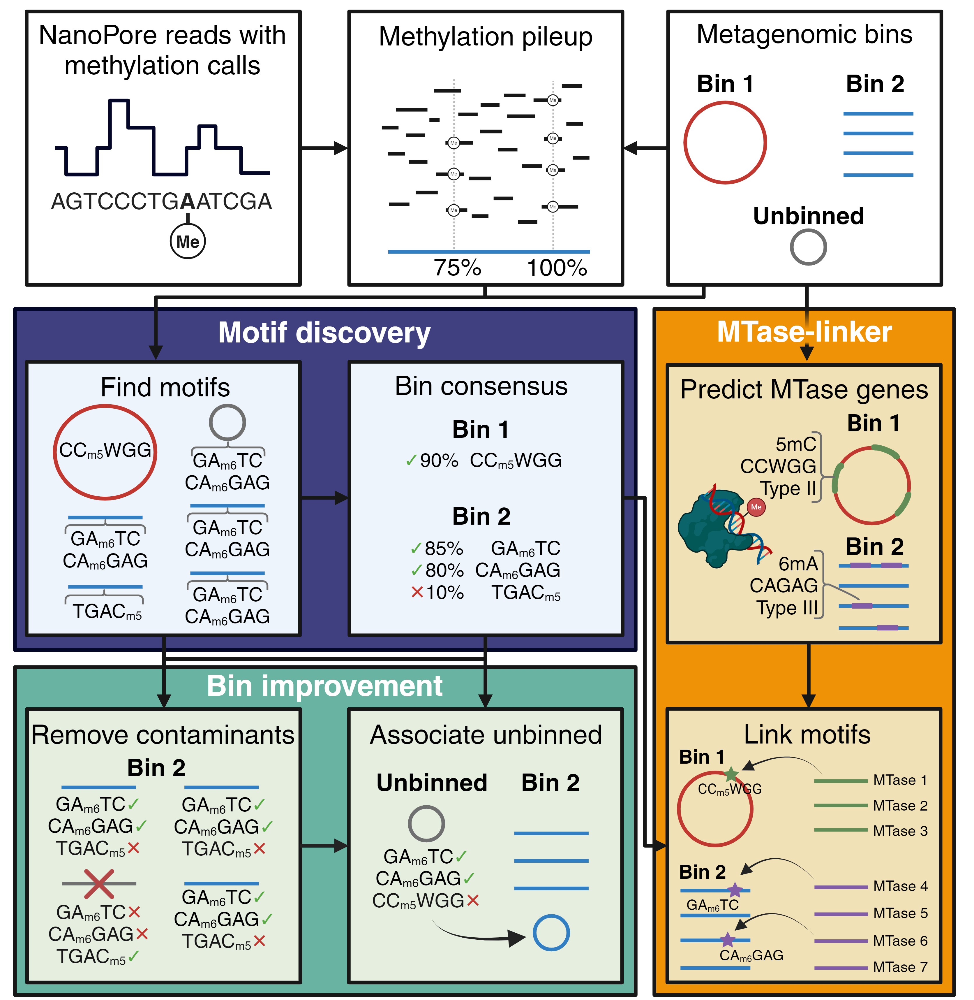

# Nanomotif
[](https://anaconda.org/bioconda/nanomotif)      [](https://badge.fury.io/py/nanomotif)

Nanomotif finds DNA methylation motifs in prokaryotic genomes and metagenomes from Nanopore sequencing
data. It finds the motifs of every bin (or genome) de novo from a modkit pileup, and its MTase-linker
module links them to the methyltransferase genes that produce them.
  - [Overview](#nanomotif-offers)
  - [Documentation](#documentation)
  - [Installation](#installation)
  - [Usage](#usage)
  - [Citation](#citation)


### Nanomotif offers
- de novo methylation motif discovery per bin, for 6mA, 5mC and 4mC
- association of MTases and RM systems with the motifs (MTase-linker)
- speed on large metagenomes: about 20 s for a 12-bin mock community with a 4 GB pileup, 21 minutes for a
  490-bin metagenome with a 330 GB pileup
<p align="center">
  
</p>


## Documentation
See the [documentation](https://nanomotif.readthedocs.io) for installation and usage, the required
files, the output, [how it works](https://nanomotif.readthedocs.io/en/latest/how_it_works.html) and
examples.


## Quick start

### Installation

```shell
python3 -m venv nanomotif
source nanomotif/bin/activate
pip install nanomotif
```

On Linux, macOS and Windows (x86_64), this includes Nanomotif's compiled kernels (`nanomotif-rs`) as a
prebuilt wheel; no compiler is needed. Nanomotif is also on Bioconda:
`conda install -c conda-forge -c bioconda nanomotif`.

Check the installation with a small test run:
```shell
nanomotif check_installation
```

### Required files

- the assembly (FASTA)
- a [modkit](https://github.com/nanoporetech/modkit/blob/master/book/src/advanced_usage.md#pileup)
  methylation pileup (plain or bgzipped)
- the bin of each contig: a tab-separated `contig<TAB>bin` file, or the bin FASTA files

See [required files](https://nanomotif.readthedocs.io/en/latest/required_files.html) for how to make them.

### Motif discovery

For monocultures and metagenomes alike:

```shell
nanomotif motif_discovery ASSEMBLY.fasta PILEUP.bed -c CONTIG_BIN.tsv -t THREADS --out OUT
```

The motifs of each bin are written to `OUT/bin-motifs.tsv`. See
[usage](https://nanomotif.readthedocs.io/en/latest/usage.html) and
[output](https://nanomotif.readthedocs.io/en/latest/output.html).

### MTase-linker

This module links methylation motifs to their MTase and, when present, their entire RM system. It needs
additional dependencies, installed once with (requires conda):

```shell
nanomotif MTase-linker install
```

This creates a folder `ML_dependencies` in the current directory (`--dependency_dir` to change it). Then:

```shell
nanomotif MTase-linker run -t 10 --assembly ASSEMBLY.fasta --contig_bin contig_bin.tsv \
    --bin_motifs OUT/bin-motifs.tsv -d ML_dependencies -o mtase_linker
```

It writes `mtase_assignment_table.tsv`, the predicted MTase genes and whether a motif could be linked to
each, and `nanomotif_assignment_table.tsv`, `bin-motifs.tsv` with the linked genes and candidates.

### Bin contamination and inclusion

The `detect_contamination` and `include_contigs` commands were removed in version 1.2.0. For bin
refinement from methylation, see [EpiRefine](https://github.com/SorenHeidelbach/epirefine).

### What's new

See the [changelog](CHANGELOG.md).

## Citation

Please cite our preprint if you use Nanomotif for your research:

Nanomotif: Leveraging DNA Methylation Motifs for Genome Recovery and Host Association of Plasmids in Metagenomes from Complex Microbial Communities.
Søren Heidelbach, Sebastian Mølvang Dall, Jeppe Støtt Bøjer, Jacob Nissen, Lucas Nicolaas Ludovic van der Maas, Mantas Sereika, Rasmus Kirkegaard, Sabrina Just Kousgaard, Ole Thorlacius-Ussing, Sheila I Jensen, Katja Hose, Thomas Dyhre Nielsen, Mads Albertsen. Preprint at *bioRxiv* https://doi.org/10.1101/2024.04.29.591623 (2024)

## License

Nanomotif is released under the [MIT License](LICENSE). Feel free to use, modify, and distribute the package in accordance with the terms of the license.

## Acknowledgments

Nanomotif builds upon various open-source libraries and tools that are instrumental in its functionality. We would like to express our gratitude to the developers and contributors of these projects for their valuable work.


